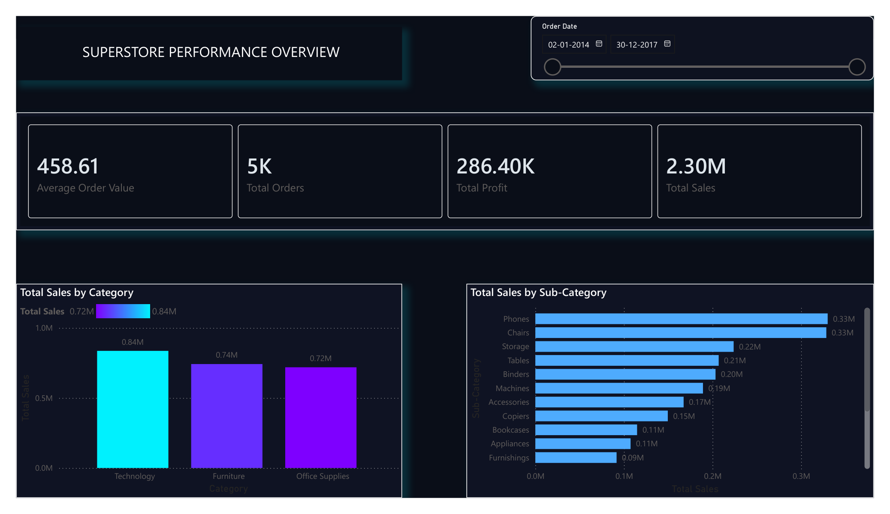
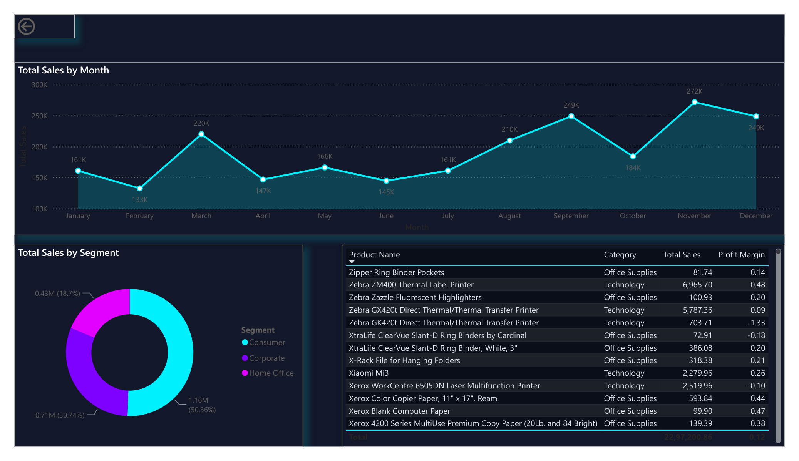
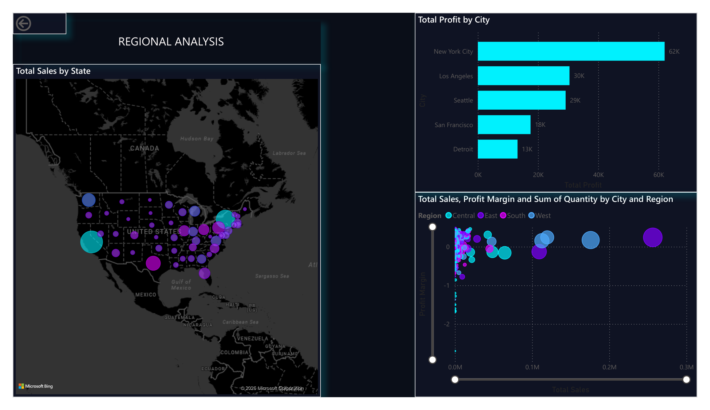

# 📊 Superstore Sales Analytics Dashboard

> **Project Status:** Completed (February 18, 2024) | **Maintainer:** R Vikram

## 1. Project Title & Overview
**Superstore Sales & Commercial Analytics** is an executive retail performance dashboard evaluating sales trajectory, regional profitability, category margins, and discount sensitivity across 9,994 retail orders in the United States. Built in Power BI with supporting SQL validation queries, the project identifies key commercial margin drivers and loss-making product sub-categories.

---

## 2. Business Problem
Retail enterprises operating nationwide across multiple channels often suffer from unseen profitability bleed: top-line revenue expansion can mask acute margin erosion caused by unconstrained promotional discounting. Executive leadership required diagnostic answers to:
1. Which US regions and states generate sustainable net profit versus operational losses?
2. Why is the Furniture category producing an anemic 2.49% profit margin despite generating over $742K in gross sales?
3. What is the quantitative relationship between discount levels (>20%) and net margin destruction?
4. How do order delivery speeds and fulfillment ship modes impact order frequency and profitability?

---

## 3. Project Objectives
* Standardize dirty date formats and validate regional mappings across 9,994 order line items.
* Model clean star schema relationships in Power BI and author verified DAX measures (`_Measures (2)`).
* Develop a production-grade analytical SQL suite (`SQL/superstore_analytics.sql`) to validate executive KPIs.
* Export high-resolution dashboard visuals to enable rapid recruiter review without requiring Power BI Desktop.
* Synthesize actionable discounting guardrails and regional turnaround strategies.

---

## 4. Dataset Description
* **Source:** [Tableau Public - Sample Superstore Dataset](https://community.tableau.com/s/question/0D54T00000CWeX8SAL/sample-superstore-sales-excelxls) / [Kaggle Mirror](https://www.kaggle.com/datasets/vivek468/superstore-dataset-final)
* **Sample Size:** 9,994 transaction rows.
* **Attributes:** 21 attributes (Order Dates, Customer Segments, Regional Geography, Categories, Sales, Discount, Profit).
* **Timeframe:** 4 Operating Years (02/01/2014 – 30/12/2017).

---

## 5. Tools & Technologies
* **Power BI Desktop:** 3-page executive dashboard, custom KPI cards, interactive cross-filtering.
* **DAX:** Calculated measures for Sales, Profit, Profit Margin %, Order Count, and AOV.
* **SQL (ANSI SQL / PostgreSQL / MySQL):** Table DDL, regional aggregation, discount sensitivity modeling.
* **PyMuPDF:** Automated extraction of high-resolution dashboard visual previews.

---

## 6. Data Architecture
The data model is structured around the `Sample - Superstore` fact table in Power BI:
* **Temporal Dimension:** `Order Date`, `Ship Date`, Month-Year Hierarchies.
* **Geographical Dimension:** `Country`, `Region` (West, East, Central, South), `State`, `City`, `Postal Code`.
* **Customer Dimension:** `Customer ID`, `Customer Name`, `Segment` (Consumer, Corporate, Home Office).
* **Product Dimension:** `Product ID`, `Category`, `Sub-Category`, `Product Name`.
* **Fact Metrics:** `Sales`, `Quantity`, `Discount`, `Profit`.

---

## 7. Data Cleaning Methodology
Data preparation steps implemented prior to dashboard loading:
1. **Date Standardization:** Standardized order and shipment timestamps to unified `YYYY-MM-DD` date formats.
2. **Data Type Enforcement:** Cast `Sales`, `Profit`, and `Discount` to high-precision decimal currency fields.
3. **Regional Integrity:** Verified consistency between US State names, Postal Codes, and assigned macro-regions.
4. **Calculated Column Verification:** Ensured `Profit Margin = Profit / Sales` handles zero-sale transactions safely.

---

## 8. SQL Analysis
The project includes a complete analytical SQL suite in [SQL/superstore_analytics.sql](SQL/superstore_analytics.sql):
* Table DDL schemas with primary key constraints.
* Commercial KPI calculations (Total Sales, Total Profit, Margin %, AOV).
* Regional profitability rankings and top/bottom state performance.
* Category and sub-category profitability matrix (identifying loss leaders).
* Discount bracket elasticity analysis and shipping mode transit times.

---

## 9. Power BI Dashboard
The dashboard [Superstore_Sales_Dashboard.pbix](Superstore_Sales_Dashboard.pbix) comprises 3 dedicated executive analytical pages:
1. **Superstore Performance Overview:** High-level scorecard ($2.30M Sales, $286.40K Profit, 12.47% Margin), monthly revenue trajectory, and category sales vs profit comparisons.
2. **Sales Trend & Monthly Analysis:** In-depth seasonal decomposition tracking Q4 revenue surges vs Q1 troughs across consecutive operating years.
3. **Regional Analysis:** State-level sales chloropleth maps, regional margin rankings, and city-level drill-throughs.

---

## 10. Dashboard Screenshots
High-resolution dashboard previews extracted directly from the verified report:

### Page 1: Superstore Performance Overview


### Page 2: Monthly Sales Trends & Seasonality


### Page 3: Regional Sales & State Profitability


*PDF Report available at [Superstore_Sales_Dashboard.pdf](Superstore_Sales_Dashboard.pdf).*

---

## 11. Key Performance Indicators (KPIs)
| KPI | Value | Business Significance |
|:---|:---:|:---|
| **Total Sales** | $2.30M | Cumulative gross retail sales revenue |
| **Total Net Profit** | $286.40K | Net profit realized after applied discounts |
| **Profit Margin %** | 12.47% | Enterprise bottom-line conversion margin |
| **Total Orders** | 5,009 | Distinct customer invoices processed |
| **Total Units Sold** | 37,873 | Physical items shipped |
| **Average Order Value (AOV)** | $458.55 | Mean revenue per customer order |

---

## 12. Business Insights
*Detailed analytical findings available in [Documentation/Superstore_Insights.md](Documentation/Superstore_Insights.md).*
* **The Tables Loss Bleed:** The `Tables` sub-category produced **-$17,725 in cumulative losses** on $207K in sales due to reckless discounting averaging **26.1%** (frequently exceeding 40%-50%).
* **Regional Disparities:** The West Region is the top commercial engine ($108.4K profit, 14.9% margin), whereas the Central Region lags at only 7.9% margin, dragged down by severe losses in Texas (-$25.7K) and Illinois (-$12.6K).
* **Technology Margin Leadership:** Technology generates the highest profit margin (**17.40%**), driven by Copiers (31.7% margin) and Phones ($44.5K profit).

---

## 13. Strategic Recommendations
1. **Mandatory Discount Guardrails:** Institute hard system limits preventing discounts on Furniture above 15% without regional director sign-off.
2. **Central Region Turnaround:** Re-evaluate carrier contracts and commercial pricing in Texas and Illinois to stem combined state losses of -$38.3K.
3. **Corporate SKU Promotions:** Shift paid marketing spend toward Copiers, Paper, and Accessories where unit margins consistently exceed 30%.

---

## 14. Project Folder Structure
```
superstore_sales_dashboard/
│
├── Superstore_Sales_Dashboard.pbix      # Interactive Power BI report
├── Superstore_Sales_Dashboard.pdf       # Verified 3-page PDF report
├── DATASET_GUIDE.md                     # Dataset dictionary & guide
├── SQL/
│   └── superstore_analytics.sql         # Production SQL query suite
├── Documentation/
│   ├── DAX_Measures.md                  # Comprehensive DAX catalog
│   └── Superstore_Insights.md           # Business findings & analysis
└── Screenshots/
    ├── 01_superstore_performance_overview.png
    ├── 02_sales_trend_monthly_analysis.png
    └── 03_regional_sales_state_analysis.png
```

---

## 15. Installation & Execution
```bash
# Clone the repository
git clone https://github.com/VIKRAM-1318/Data-Analyst-Portfolio.git
cd "Data-Analyst-Portfolio/superstore_sales_dashboard"

# Open the report in Power BI Desktop or review the PDF report:
# Superstore_Sales_Dashboard.pdf
```

---

## 16. Dataset Download Instructions
See [DATASET_GUIDE.md](DATASET_GUIDE.md) for full acquisition details. The official dataset can be downloaded from [Tableau Public](https://community.tableau.com/s/question/0D54T00000CWeX8SAL/sample-superstore-sales-excelxls).

---

## 17. Limitations & Future Work
* **Customer Acquisition Cost (CAC):** Dataset tracks sales and discounts but lacks marketing spend data to evaluate customer lifetime value (LTV) vs CAC.
* **Future Work:** Build an interactive price-elasticity simulator to model the exact profit impact of reducing discount tiers from 30% to 15%.

---

## 18. Contact & Maintainer
* **Developer & Maintainer:** R Vikram
* **GitHub:** [VIKRAM-1318 (R VIKRAM)](https://github.com/VIKRAM-1318)
* **Email:** `rv367629@gmail.com`
